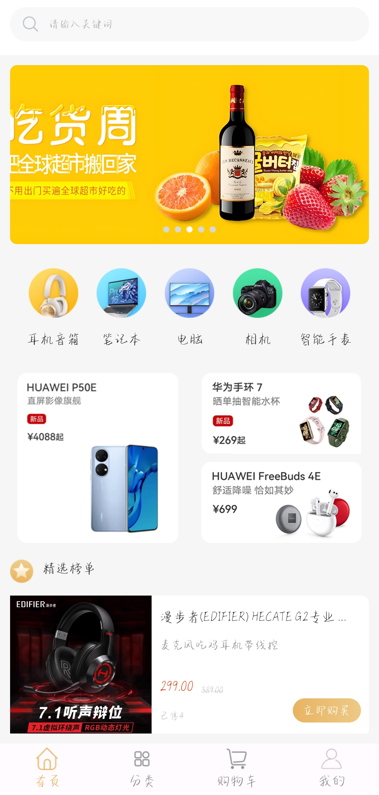
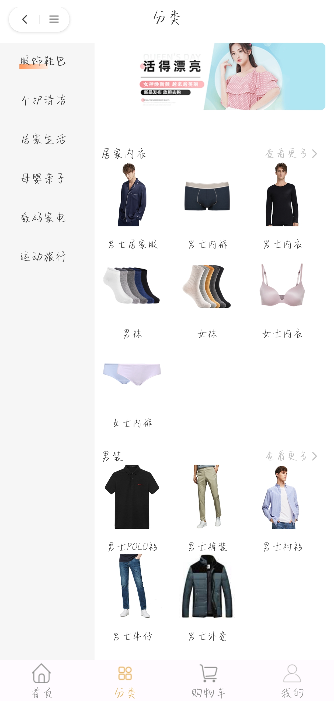
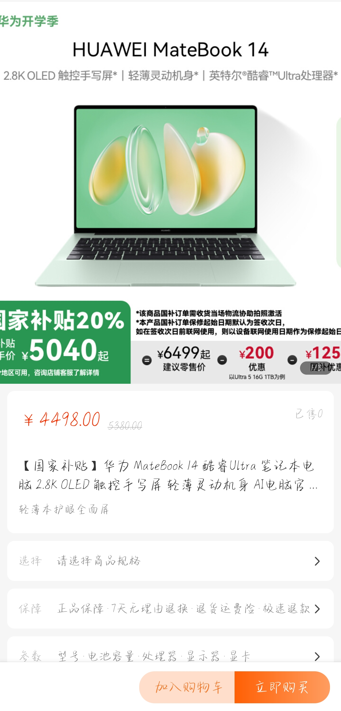
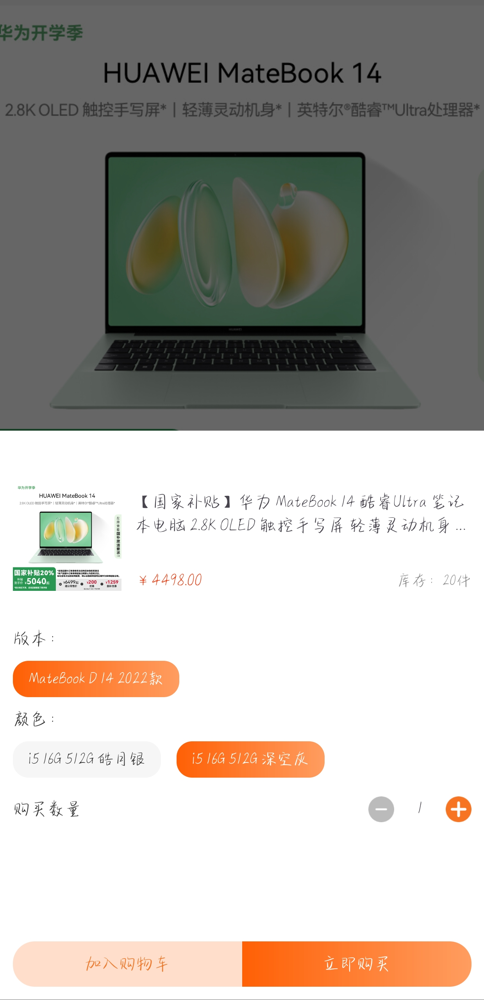
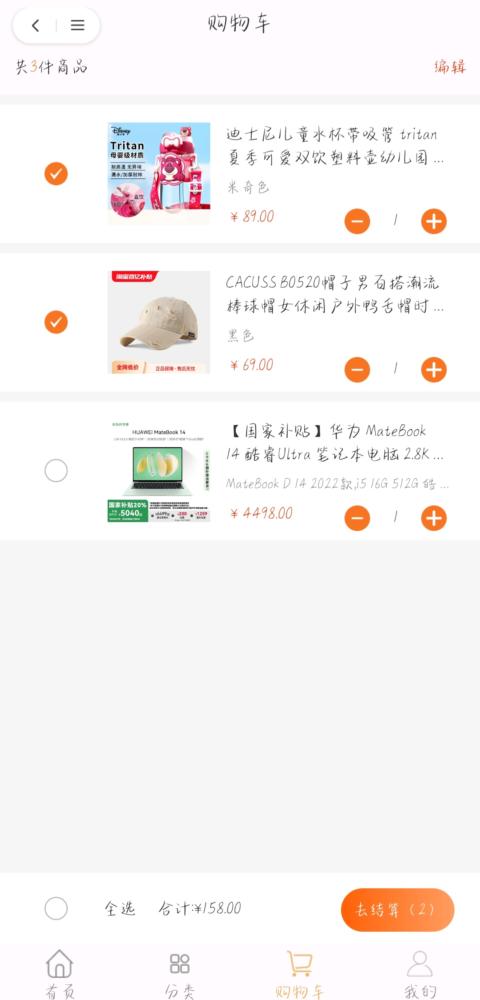
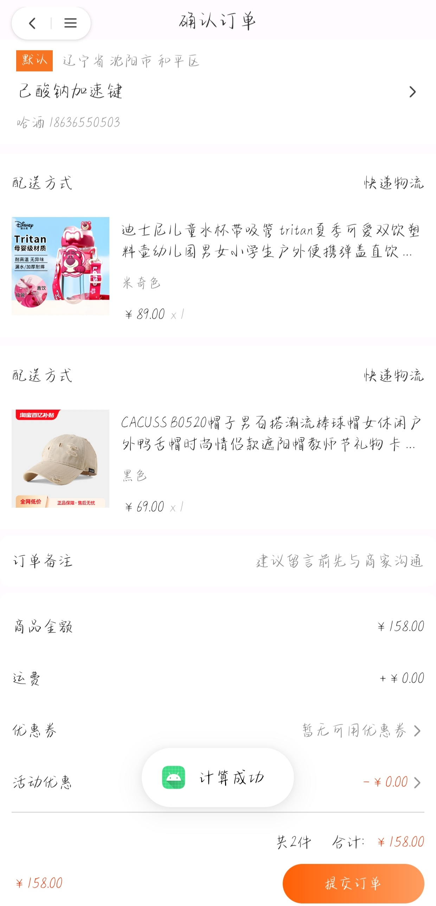

电商 App（E-Commerce Platform）

运行截图

| 首页 | 分类 | 商品详情 |
| :---: | :---: | :---: |
|  |  |  |

| SKU 规格选择 | 购物车 | 确认订单 |
| :---: | :---: | :---: |
|  |  |  |

一个基于 组件化 + MVVM 架构的 Android 电商应用，覆盖首页、分类、购物车、订单、用户等核心模块，打通「浏览商品 → 选规格 → 加购 → 下单 → 支付」的完整交易链路。


技术栈


添加到对话

分类	内容

语言	Java

架构	组件化、MVVM、DataBinding

路由	ARouter（页面跳转 + 跨模块服务暴露）

网络	Retrofit + OkHttp + Gson（含自定义 TypeAdapter）

状态管理	ViewModel + LiveData（MediatorLiveData 派生状态）

UI	RecyclerView（多 ViewType）、ViewPager2、NestedScrollView、自定义 View

其他	EventBus、Glide

项目结构


```


ECommercePlatform

├── app                  # 壳工程，负责集成各模块

├── feature\_home         # 首页 + 商品详情 + SKU 选择

├── feature\_categorize   # 分类页（三级分类联动）

├── feature\_shoppingcart # 购物车 + 确认订单

├── feature\_user         # 用户中心 + 登录 + 地址管理

├── library\_base         # 基础库（基类、通用工具、服务接口定义）

└── network              # 网络层（Retrofit 封装、多态 JSON 解析）


```


核心实现

1\. 组件化 + 跨模块服务暴露


模块之间零耦合，页面跳转统一走 ARouter。对于「跨模块调用功能」的场景（如商品详情页需要调用购物车加购、用户登录），将 CartService / LoginService 接口下沉到 library\_base，实现类在各自业务模块通过 @Route 暴露，调用方只依赖接口。


2\. 购物车状态管理


购物车的合计金额、商品总数、全选状态、按钮可用性等数据，均由「购物车列表」和「选中 ID 集合」两个数据源派生，通过 MediatorLiveData 合并监听，避免多入口手动同步导致的数据不一致。


3\. 多态 JSON 解析


首页数据由服务端配置化下发，数组每项带 type 字段、结构随 type 不同（共 6 种）。通过自定义 Gson TypeAdapter 流式解析：先读 type，再按 type 分发；未知 type 降级保留、未知字段跳过，保证脏数据不会导致整页崩溃。


4\. 商品详情页滚动联动


基于 NestedScrollView 实现「滚动显隐悬浮状态栏 + Tab 锚点高亮 + 点击 Tab 平滑滚动」三项联动。通过状态标志位去重、滚动结束后延时同步、动画结束回调取高度，解决了平滑滚动与滚动监听互相抢占导致的 Tab 高亮跳变问题。


5\. SKU 规格选择


用 Map<规格组ID, 选中项> 维护选中状态，每次选择后把当前组合与服务端下发的「规格组合明细」做匹配，命中则更新价格与库存上限。


如何运行

使用 Android Studio 打开项目

等待 Gradle 同步完成

在 local.properties 中配置你的 Android SDK 路径（该文件未纳入版本控制）

运行 app 模块

环境

compileSdk / targetSdk：34

minSdk：26

Gradle / AGP：8.4.0

该项目为个人独立开发的实践项目

